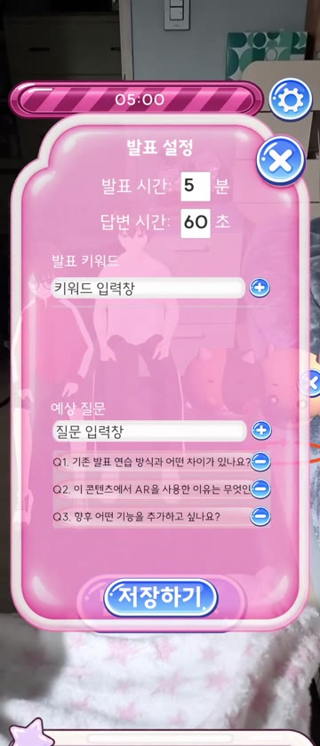
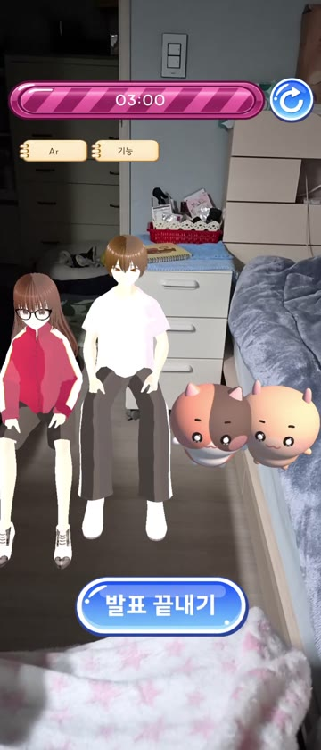
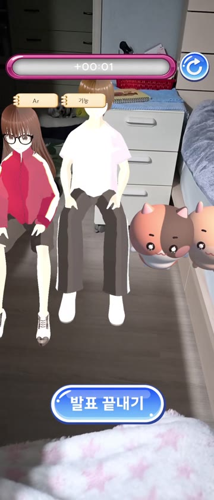
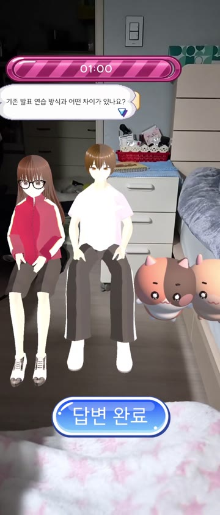
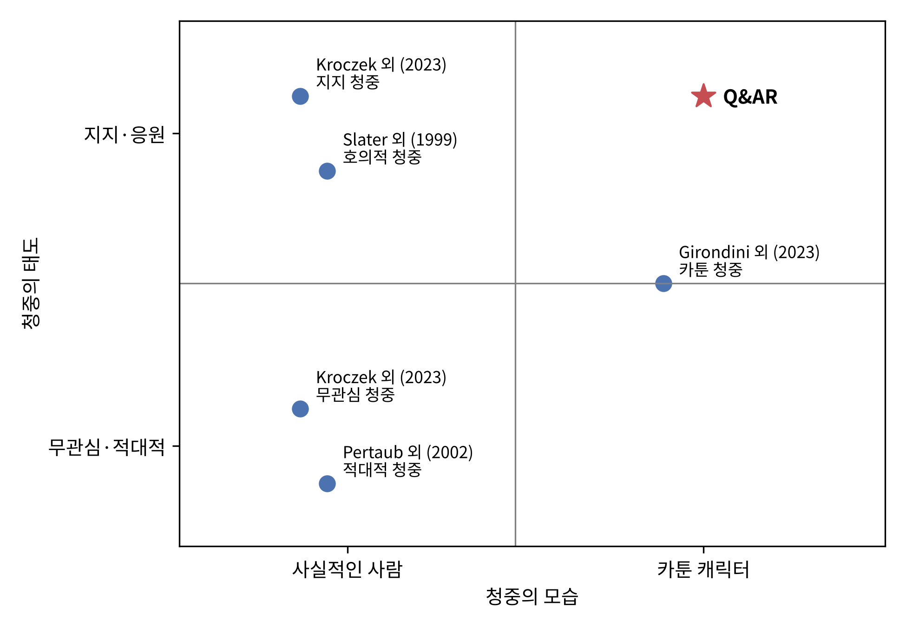
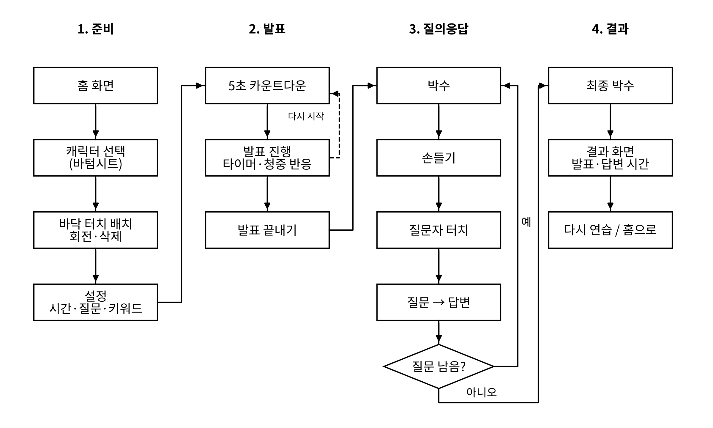
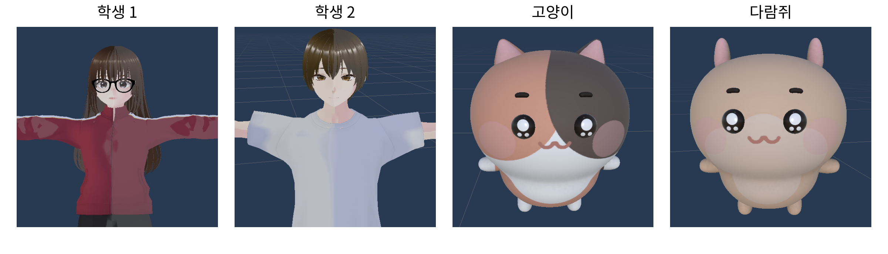

# Q&AR

### 응원해 주는 AR 청중과 함께하는 발표·질의응답 연습

어디서든 내 방을 발표장으로. 귀여운 AR 청중이 끄덕이며 들어주고, 박수 치고, 손을 들어 질문해요.

한성대학교 가상현실 · 증강현실 중간 프로젝트 (2026-2)

 

<table>
  <tr>
    <td align="center"> 메인 화면</td>
    <td align="center"> 청중 고르기</td>
    <td align="center"> 바닥에 청중 배치</td>
    <td align="center"> 발표 설정</td>
  </tr>
  <tr>
    <td align="center"> 발표 중 (타이머·키워드)</td>
    <td align="center"> 초과 시간 표시</td>
    <td align="center"> 손들고 질문하기</td>
    <td align="center"> 말풍선 질문 → 답변</td>
  </tr>
</table>

 

## 소개

혼자 발표를 연습하면 벽이나 거울을 보고 말하게 돼요. 누군가 나를 보고 있고, 발표가 끝나면 손을 들어 질문하는 상황은 만들 수 없어요.

**Q&AR**은 휴대폰 카메라로 실제 공간의 바닥을 인식하고, 그 위에 가상 청중을 앉혀서 **발표부터 질의응답까지 한 번에** 연습하게 해 주는 모바일 AR 앱이에요.

- 🐱 **귀여운 청중:** 사실적인 사람 대신 애니풍 학생 2명과 고양이·다람쥐
- 👏 **응원하는 반응:** 발표 중에는 끄덕이고 고개를 갸웃하고, 끝나면 박수
- 🙋 **질의응답:** 박수가 끝나면 모두 손을 들고, 내가 고른 청중이 질문
- ⏱️ **시간 관리:** 발표·답변 타이머, 제한 시간을 넘기면 `+00:01`부터 초과 시간 표시

 

## 왜 이렇게 만들었나요?

각 기능은 발표 연습과 가상 청중에 관한 연구 결과에서 출발했어요.

| 연구 결과 | Q&AR에 반영한 것 |
|---|---|
| 상상한 청중보다 **가상 청중** 앞에서 연습했을 때 불안 감소·만족도가 더 좋았다 (Kang 외, 2019) | 실제 공간에 가상 청중 배치 |
| **지지하는 청중** 앞에서 연습한 그룹이 실제 발표에서 자신감 평가를 더 높게 받았다 (Kroczek & Mühlberger, 2023) | 끄덕임·갸웃·박수로만 반응 (하품·딴짓 없음) |
| 청중이 사실적일수록 불안이 컸고, **카툰 청중** 앞에서는 불안이 낮았다 (Girondini 외, 2023) | 귀여운 캐릭터 청중 4종 |
| 폰 AR 발표 연습 앱에서 **정지된 청중**이 한계로 지적됐다 (SpeakAR, 2025) | 청중마다 다른 타이밍의 랜덤 반응 |
| 실제 발표에는 있던 **질의응답**이 VR 연습에는 없었다 (Kroczek & Mühlberger, 2023) | 손들기 + 질문자 터치 + 답변 시간 측정 |
| **로봇 같은 목소리**는 몰입을 깨뜨렸다 (Girondini 외, 2023) | TTS 대신 한 글자씩 뜨는 말풍선 + 웅얼거림 효과음 |

청중의 태도(지지 ↔ 무관심·적대)와 모습(사실적 ↔ 카툰)으로 정리한 가상 청중 연구

### 왜 AR인가요?

- **실제 공간 그대로:** 내 방이나 강의실은 그대로 두고 청중만 더해요. VR 가상 강의실보다 실제로 발표할 환경에 가깝게 연습할 수 있어요.
- **헤드셋 없이:** 누구나 가진 휴대폰 하나로 바로 시작해요.
- **사람을 모으지 않아도:** 청중 수와 위치를 내가 정해서, 혼자서도 여러 명 앞에서 발표하는 상황을 원할 때마다 만들 수 있어요.

 

## 진행 흐름

1. **준비:** `시작하기` → 바텀시트에서 캐릭터 선택 → 바닥 터치로 배치 (회전·삭제 가능) → 설정에서 발표 시간, 답변 시간, 키워드, 예상 질문 입력
2. **발표:** `발표 시작!` → 5초 카운트다운 → 타이머와 키워드를 보며 발표, 청중은 끄덕이며 들어줌. 막히면 `다시 시작`
3. **질의응답:** `발표 끝내기` → 박수 → 모두 손들기 → 질문할 청중 터치 → 말풍선 질문 → 답한 뒤 `답변 완료` → 다음 질문
4. **결과:** 최종 박수 → 발표 시간, 질문 수, 총 답변 시간 확인 → `다시 연습` 또는 `처음으로`

 

## 청중 캐릭터

사람 캐릭터와 동물 캐릭터는 뼈대 구조가 달라서, 같은 Animator 구조에 **Animator Override Controller**로 캐릭터마다 애니메이션만 바꿔 끼웠어요. 동물은 박수 동작 대신 짧은 점프를 반복해요.

 

## 기술 스택

| 분류 | 사용 기술 |
|---|---|
| 엔진 | Unity 6 (6000.3.22f1), URP |
| AR | Vuforia Engine 11.4.4 (Ground Plane · Plane Finder) |
| 캐릭터 | VRoid Studio (VRM) + UniVRM, LittleFriends - Cartoon Animals Lite |
| 애니메이션 | Mixamo, Universal Animation Library, Animator Override Controller |
| UI | Unity UI, TextMeshPro |
| 사운드 | AudioSource (박수·카운트다운·말소리 효과음, pitch 랜덤) |
| 플랫폼 | Android |

### 주요 스크립트 (`Assets/Scripts`)

| 스크립트 | 역할 |
|---|---|
| `HomeManager.cs` | 홈 화면과 AR 화면 전환 |
| `BottomSheetDrag.cs` | 위로 밀어 올리는 청중 선택 바텀시트 |
| `CharacterPlacementManager.cs` | Ground Plane 위 터치 위치에 캐릭터 배치 |
| `AudienceEditManager.cs` | 배치한 청중 선택·회전·삭제, 발표 중 편집 잠금 |
| `SettingsManager.cs` | 발표·답변 시간, 질문·키워드 추가/삭제 |
| `PresentationTimer.cs` | 카운트다운, 발표·답변 타이머, 초과 시간 표시 |
| `PresentationManager.cs` | 발표 → 박수 → 손들기 → 질문자 선택 흐름 제어 |
| `AudienceBehavior.cs` | 청중별 랜덤 반응, 박수, 손들기 애니메이션 |
| `QuestionManager.cs` | 말풍선 질문 타이핑 효과, 말풍선 위치, 결과 집계 |
| `AudioManager.cs` | 효과음 통합 관리, 말소리 pitch 랜덤 |

 

## 실행 방법

1. 이 저장소를 받고 **Unity 6000.3.22f1**로 프로젝트를 열어요.
2. **Vuforia Engine 11.4.4 패키지가 필요해요.** 파일 크기(132MB)가 GitHub 제한을 넘어서 저장소에는 넣지 않았어요.
   - [Vuforia Developer Portal](https://developer.vuforia.com/downloads/sdk)에서 `com.ptc.vuforia.engine-11.4.4.tgz`를 받아 `Packages/` 폴더에 넣어 주세요.
3. `Assets/Scenes/MainScene.unity`를 열어요.
4. **File → Build Profiles → Android**로 바꾼 뒤 휴대폰에 빌드해요. Ground Plane은 ARCore를 지원하는 안드로이드 기기에서 동작해요.

> 💡 바닥 인식은 밝고 무늬가 있는 바닥에서 잘 돼요.

 

## 한계와 향후 계획

**지금의 한계**
- 어둡거나 무늬가 없는 바닥에서는 바닥 인식이 잘 안 돼요.
- 청중 반응이 랜덤 타이밍이라 내 말에 맞춰 반응하지는 않아요.
- 질문은 입력한 순서대로만 나오고, 꼬리질문은 못 해요.
- 연습 효과는 아직 검증하지 않았어요.

**앞으로 하고 싶은 것**
- 🎙️ 음성 인식으로 말 속도·멈춤에 맞춰 반응하는 청중
- 🖼️ 내가 넣은 사진으로 청중 얼굴을 바꿔 실제 발표 상황에 가깝게
- 📈 귀여운 캐릭터 → 사실적인 사람으로 현실감 단계 올리기
- 🤖 발표 자료를 바탕으로 한 AI 예상 질문과 꼬리질문
- 💼 면접 모드, AR 글래스 지원

 

## 사용한 에셋

- AR: [Vuforia Engine](https://developer.vuforia.com/) (Ground Plane)
- 학생 캐릭터: VRoid Studio로 만든 VRM 모델, [UniVRM](https://github.com/vrm-c/UniVRM)
- 동물 캐릭터: LittleFriends - Cartoon Animals Lite (Unity Asset Store)
- 애니메이션: [Mixamo](https://www.mixamo.com/), Universal Animation Library
- 효과음: [Pixabay](https://pixabay.com/) 무료 효과음

 

## 참고 문헌

1. N. Kang 외, "Public speaking training in front of an imaginary or virtual audience: A randomized controlled trial," *Annual Review of CyberTherapy and Telemedicine*, 17, 2019.
2. L. O. H. Kroczek, A. Mühlberger, "Public speaking training in front of a supportive audience in Virtual Reality improves performance in real-life," *Scientific Reports*, 13, 13968, 2023. [doi](https://doi.org/10.1038/s41598-023-41155-9)
3. M. Girondini 외, "Speaking in front of cartoon avatars," *International Journal of Human-Computer Studies*, 179, 103106, 2023. [doi](https://doi.org/10.1016/j.ijhcs.2023.103106)
4. M. E. Jim 외, "Speak with Confidence: Designing an Augmented Reality Training Tool for Public Speaking," PCSC 2025. [arXiv](https://arxiv.org/abs/2504.11380)
5. Y. Min, J. W. Jeong, "Public Speaking Q&A Practice with LLM-Generated Personas in Virtual Reality," IEEE ISMAR-Adjunct 2024. [doi](https://doi.org/10.1109/ISMAR-Adjunct64951.2024.00143)
6. A. C. F. Marinho 외, "Fear of Public Speaking: Perception of College Students and Correlates," *Journal of Voice*, 31(1), 2017. [doi](https://doi.org/10.1016/j.jvoice.2015.12.012)

 

만든 사람 · **김예민** ([@shiwjz](https://github.com/shiwjz))

