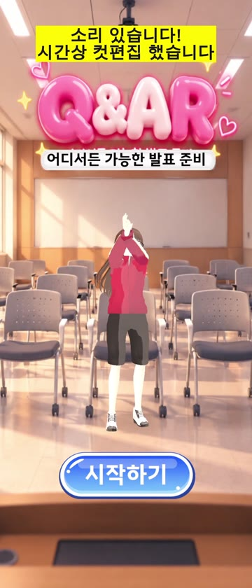
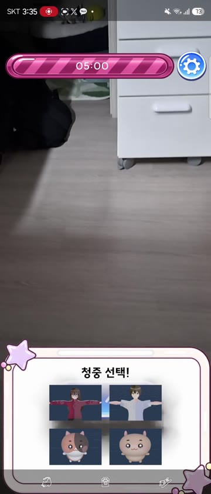
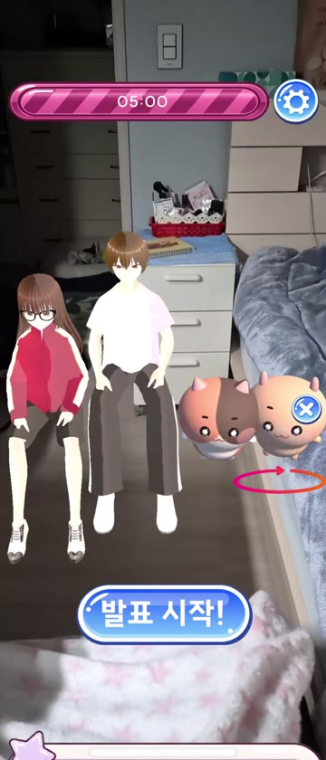
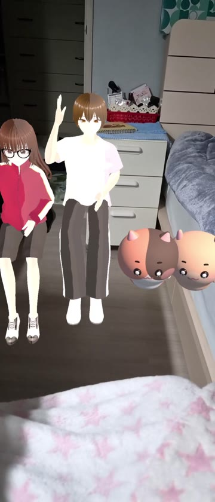

# Q&AR (큐앤에이알)

> 내 방 바닥에 귀여운 AR 청중을 앉혀 두고  
> 발표부터 질의응답까지 혼자 연습할 수 있는  
> **모바일 AR 발표 연습 앱**입니다.

한성대학교 **가상현실 수업 중간 프로젝트**로 제작했으며,  
기획부터 구현, 보고서까지 **1인 개발**로 진행했습니다.

---

## 📱 Overview

- 장르: AR 발표·질의응답 연습
- 플랫폼: Android
- 엔진: Unity 6 (6000.3.22f1)
- AR: Vuforia Engine 11.4.4 (Ground Plane)
- 팀 구성: 1인
- 내 역할: 기획 / 프로그래밍 / UI

---

## 🖼️ Screenshots

| Main | Audience | Placement | Settings |
|---|---|---|---|
|  |  |  |  |

| Presenting | Overtime | Hand Raise | Question |
|---|---|---|---|
|  |  |  |  |

---

## 💡 Concept

혼자 발표를 연습하면 벽이나 거울을 보고 말하게 된다.  
누군가 나를 보고 있고, 발표가 끝나면 손을 들어 질문하는 상황은 만들 수 없다.

그래서 **휴대폰 카메라로 실제 공간의 바닥을 인식하고**,  
그 위에 가상 청중을 앉혀 **발표 → 박수 → 질의응답**을 한 번에 연습하는 앱을 기획했다.

청중은 사실적인 사람 대신 **귀여운 캐릭터**로,  
반응은 하품이나 딴짓 없이 **끄덕여 주고 박수 쳐 주는 응원**으로만 구성했다.

---

## ✨ Key Features

- 바닥 인식 후 터치한 위치에 청중 배치 (회전·삭제 가능)
- 청중 4종: 애니풍 학생 2명 + 고양이·다람쥐
- 발표 시간, 답변 시간, 발표 키워드, 예상 질문 직접 설정
- 5초 카운트다운 후 발표 타이머 시작
- 제한 시간을 넘기면 `+00:01`부터 초과 시간 표시
- 발표 중 청중이 랜덤 타이밍으로 끄덕이거나 고개를 갸웃함
- 발표가 끝나면 박수 → 모두 손들기 → 내가 터치한 청중이 질문
- 질문은 한 글자씩 뜨는 말풍선 + 웅얼거리는 캐릭터 말소리
- 막히면 `다시 시작`, 끝나면 결과 화면에서 발표·답변 시간 확인

---

## 🔁 Flow

1. `시작하기` → 바텀시트에서 캐릭터를 골라 바닥에 배치한다
2. 설정에서 발표 시간, 답변 시간, 키워드, 예상 질문을 입력한다
3. `발표 시작!` → 카운트다운 후 발표한다
4. `발표 끝내기` → 청중이 박수를 치고 손을 든다
5. 질문할 청중을 터치하고, 말풍선 질문에 답한 뒤 `답변 완료`를 누른다
6. 질문을 모두 마치면 결과 화면에서 `다시 연습` 또는 `처음으로`를 고른다

---

## 📚 Why This Design

기능마다 발표 연습·가상 청중 연구를 근거로 삼았다.

| 연구 결과 | 반영한 기능 |
|---|---|
| 상상한 청중보다 가상 청중 앞 연습이 불안 감소·만족도가 더 좋음 (Kang 외, 2019) | 실제 공간에 가상 청중 배치 |
| 지지하는 청중 앞에서 연습한 그룹이 실제 발표 자신감 평가가 더 높음 (Kroczek & Mühlberger, 2023) | 끄덕임·갸웃·박수로만 반응 |
| 사실적인 청중일수록 불안이 크고 카툰 청중 앞에서는 낮음 (Girondini 외, 2023) | 귀여운 캐릭터 청중 |
| 폰 AR 발표 연습 앱에서 정지된 청중이 한계로 지적됨 (SpeakAR, 2025) | 청중마다 다른 랜덤 반응 |
| 실제 발표엔 있던 질의응답이 VR 연습에는 없었음 (Kroczek & Mühlberger, 2023) | 손들기 + 질문자 선택 + 답변 시간 측정 |
| 로봇 같은 목소리는 몰입을 깨뜨림 (Girondini 외, 2023) | TTS 대신 말풍선 + 말소리 효과음 |

**왜 AR인가?**

- 내 방이나 강의실은 그대로 두고 청중만 더해서, 실제로 발표할 환경에 가깝게 연습할 수 있다
- VR 헤드셋 없이 휴대폰 하나로 바로 시작할 수 있다
- 사람을 모으지 않아도 여러 명 앞에서 발표하는 상황을 원할 때마다 만들 수 있다

---

## 🐱 Characters

사람과 동물은 뼈대 구조가 달라서 같은 Animator 구조에  
**Animator Override Controller**로 캐릭터마다 애니메이션만 바꿔 끼웠다.  
동물은 박수 대신 짧은 점프를 반복한다.

---

## 🧩 What I Did

- 전체 기획 및 연구 근거 조사 (발표 불안, 가상 청중 선행연구)
- Vuforia Ground Plane 기반 청중 배치 구현
- 청중 선택 바텀시트, 회전·삭제, 발표 중 편집 잠금 구현
- 발표·답변 타이머 및 초과 시간 표시 구현
- 청중 랜덤 반응, 박수, 손들기 애니메이션 연결
- 발표 → 박수 → 손들기 → 질문자 선택 → 질문 흐름 구현
- 말풍선 타이핑 효과와 pitch 랜덤 말소리 구현
- VRoid로 학생 캐릭터 제작, UI 이미지 배치
- 안드로이드 빌드 및 시연 영상 제작

### Scripts

| Script | 역할 |
|---|---|
| `HomeManager.cs` | 홈 화면과 AR 화면 전환 |
| `BottomSheetDrag.cs` | 위로 밀어 올리는 청중 선택 바텀시트 |
| `CharacterPlacementManager.cs` | 바닥 터치 위치에 캐릭터 배치 |
| `AudienceEditManager.cs` | 청중 선택·회전·삭제, 발표 중 편집 잠금 |
| `SettingsManager.cs` | 발표·답변 시간, 질문·키워드 설정 |
| `PresentationTimer.cs` | 카운트다운, 발표·답변 타이머, 초과 시간 |
| `PresentationManager.cs` | 발표 → 박수 → 손들기 → 질문자 선택 흐름 |
| `AudienceBehavior.cs` | 청중별 랜덤 반응, 박수, 손들기 |
| `QuestionManager.cs` | 말풍선 질문 타이핑, 말풍선 위치, 결과 집계 |
| `AudioManager.cs` | 효과음 관리, 말소리 pitch 랜덤 |

---

## 📦 How to Run

1. 프로젝트를 Unity 6000.3.22f1로 열기
2. Vuforia Engine 11.4.4 패키지 넣기
   - 파일 크기(132MB)가 GitHub 제한을 넘어서 저장소에는 포함하지 않았습니다
   - [Vuforia Developer Portal](https://developer.vuforia.com/downloads/sdk)에서 `com.ptc.vuforia.engine-11.4.4.tgz`를 받아 `Packages/` 폴더에 넣어 주세요
3. `Assets/Scenes/MainScene.unity` 열기
4. Android로 빌드 (ARCore 지원 기기 필요)

> 바닥 인식은 밝고 무늬가 있는 바닥에서 잘 됩니다.

---

## 🛠️ Assets

- AR: Vuforia Engine (Ground Plane)
- 학생 캐릭터: VRoid Studio (VRM) + UniVRM
- 동물 캐릭터: LittleFriends - Cartoon Animals Lite (Unity Asset Store)
- 애니메이션: Mixamo, Universal Animation Library
- 효과음: Pixabay

---

## 📌 Notes

- 처음에는 단순히 가상 청중을 띄우는 앱을 생각했지만,  
  선행 사례(SpeakAR)를 찾아보고 **청중이 반응하고 질문하는 것**을 차별점으로 잡았습니다.
- 현재는 청중 반응이 랜덤 타이밍이고 질문도 입력한 순서대로만 나와서,  
  앞으로 **음성 인식으로 말에 맞춰 반응하는 청중**, **AI 예상 질문과 꼬리질문**,  
  **내가 넣은 사진으로 청중 얼굴 바꾸기**를 추가해 보고 싶습니다.

### References

- Kang 외, *Public speaking training in front of an imaginary or virtual audience*, Annual Review of CyberTherapy and Telemedicine, 2019
- Kroczek & Mühlberger, *Public speaking training in front of a supportive audience in Virtual Reality improves performance in real-life*, Scientific Reports, 2023
- Girondini 외, *Speaking in front of cartoon avatars*, International Journal of Human-Computer Studies, 2023
- Jim 외, *Speak with Confidence: Designing an AR Training Tool for Public Speaking* (SpeakAR), PCSC 2025
- Min & Jeong, *Public Speaking Q&A Practice with LLM-Generated Personas in Virtual Reality*, IEEE ISMAR-Adjunct 2024

---

# Q&AR

> A mobile AR app where cute virtual audience members sit on your real floor,  
> so you can rehearse a presentation **and** the Q&A that follows, all by yourself.

This was my **midterm project for the Virtual Reality course** at Hansung University,  
built solo from planning to implementation.

---

## Overview

- Genre: AR presentation & Q&A practice
- Platform: Android
- Engine: Unity 6 (6000.3.22f1)
- AR: Vuforia Engine 11.4.4 (Ground Plane)
- Team: Solo
- Role: Planning / Programming / UI

---

## Key Features

- Place audience members by tapping on the detected floor (rotate / delete)
- 4 audience characters: 2 anime-style students, a cat and a squirrel
- Set presentation time, answer time, keywords and expected questions
- 5-second countdown, presentation timer, and overtime display (`+00:01`)
- Audience nods and tilts their heads at random timings while you speak
- Applause → everyone raises a hand → the one you tap asks a question
- Questions appear in a typing speech bubble with cute babble sounds
- Restart anytime, and check your presentation and answer times at the end

---

## Notes

Each feature is based on research on virtual audiences:  
supportive audiences improved real-life speaking confidence,  
and cartoon audiences caused less anxiety than realistic ones.

Next, I'd like to add an audience that reacts to my voice,  
AI-generated follow-up questions, and custom audience faces from my own photos.
